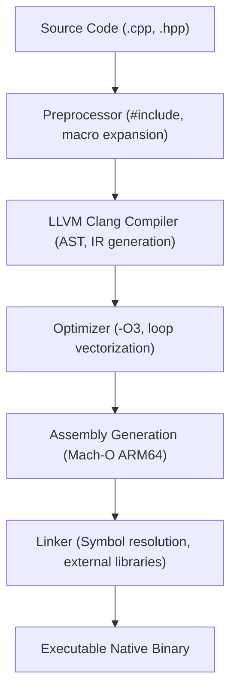
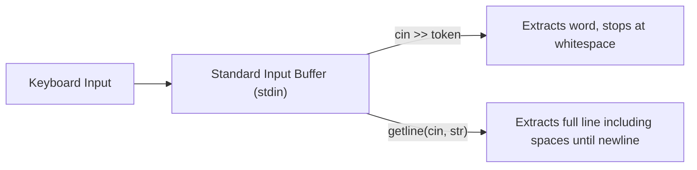

# Working with C++

Technical notes, source code, and systems-level experiments covering C++ fundamentals, memory behavior, compiler mechanics, and numeric libraries.

---

## Core Technical Concepts

### 1. Hardware Memory and Cache Latency

Direct memory access speed depends on data proximity to the CPU arithmetic logic units:

| Memory Level | Typical Latency | Access Cycles | Role |
| :--- | :--- | :--- | :--- |
| CPU Registers | ~0.3 ns | 1 cycle | Direct arithmetic and pointer operations |
| L1 Cache | ~1.2 ns | 4 cycles | Per-core instruction and data cache |
| L2 Cache | ~3.5 ns | 12 cycles | Mid-level per-core cache |
| L3 Cache | ~12 ns | 40 cycles | Shared cache across cores |
| Main Memory (RAM) | ~60 ns | ~200 cycles | Virtual memory pages, heap, dynamic allocations |

---

### 2. Compilation and Build Pipeline



---

### 3. Data Types and Memory Specifications

Reference data compiled from platform specifications and code notes:

| Data Type | Typical Size | Minimum Size | Range / Precision | Category |
| :--- | :--- | :--- | :--- | :--- |
| `bool` | 1 byte | 1 byte | true / false | Primitive |
| `char` | 1 byte | 1 byte | -128 to 127 (signed) / 0 to 255 (unsigned) | Primitive |
| `short` | 2 bytes | 2 bytes | -32,768 to 32,767 | Primitive |
| `int` | 4 bytes | 2 bytes | -2,147,483,648 to 2,147,483,647 | Primitive |
| `long` | 8 bytes (macOS 64-bit) | 4 bytes | -9.2 quintillion to 9.2 quintillion | Primitive |
| `long long` | 8 bytes | 8 bytes | -9.2 quintillion to 9.2 quintillion | Primitive |
| `float` | 4 bytes | 4 bytes | ~7 decimal digits (IEEE-754 single precision) | Primitive |
| `double` | 8 bytes | 8 bytes | ~15 decimal digits (IEEE-754 double precision) | Primitive |
| `void` | 0 bytes | 0 bytes | Incomplete type / valueless return | Primitive |
| Array | N * sizeof(T) | Depends on T | Contiguous collection of identical elements | Derived |
| Pointer (`*`) | 8 bytes (64-bit) | 8 bytes | Virtual memory address storage | Derived |
| Reference (`&`) | 8 bytes (alias) | Architecture | Direct alias to an existing memory location | Derived |
| `struct` | Sum of members + padding | 1 byte min | User-defined contiguous data bundle | User-Defined |
| `class` | Sum of members + vtable | 1 byte min | Encapsulated OOP data structure | User-Defined |
| `enum` | 4 bytes | 1 to 4 bytes | Named set of integral constants | User-Defined |
| `union` | Size of largest member | Architecture | Overlapping shared memory allocation | User-Defined |
| `typedef` | Alias size | N/A | Semantic type alias definition | User-Defined |

---

### 4. Binary Representation and Integer Modifiers

- Signed 32-bit integers reserve the most significant bit (MSB) as the sign indicator using two's complement notation.
- The `unsigned` modifier converts all 32 bits into magnitude, shifting the range from $[-2^{31}, 2^{31}-1]$ strictly to $[0, 2^{32}-1]$ ($0$ to $4,294,967,295$).
- Assigning a negative value to an unsigned type triggers modulo arithmetic:
  An unsigned int assigned `-100` wraps around to `4294967196` ($2^{32} - 100$, hexadecimal `0xFFFFFF9C`).

---

### 5. Stream I/O and Buffer Architecture



- `cin >>`: Leaves trailing newline characters in the buffer.
- `getline(cin, string)`: Consumes the newline character, extracting multi-word input cleanly.

---

## Repository Structure

```plaintext
cpp/
├── code_notes/
│   ├── intro_to_cpp/
│   │   ├── intro.cpp          # Hello World and basic I/O
│   │   ├── v2.cpp             # Custom namespaces, standard streams, Eigen matrix operations
│   │   ├── cpp_intro.txt      # Compilation stages, language background
│   │   └── cpp_v2.txt         # Namespaces and header inclusion mechanics
│   │
│   ├── 01_varconst/
│   │   ├── v3.cpp             # Variables, const qualification, stream chaining
│   │   └── cpp_v3.txt         # Data pipeline: Store -> Process -> Display
│   │
│   └── 02_datatype/
│       ├── v4.cpp             # Core primitive types in action
│       ├── modifier.cpp       # Signed vs. unsigned modifiers and wrap-around
│       ├── typecasting.cpp    # Explicit casting and to_string conversion
│       ├── myString.cpp       # Strings and escape characters
│       ├── user_ip.cpp        # cin vs. getline buffer handling
│       └── v4.txt             # Detailed reference on primitive, derived, and user types
│
├── .vscode/                   # Editor include path configurations
├── .clangd                    # Clang language server flags
├── Makefile                   # Build automation
└── README.md                  # Project documentation
```

---

## How to Compile and Run

### Standard Compilation
Using Apple Clang:
```zsh
clang++ -std=c++17 -Wall -Wextra code_notes/02_datatype/user_ip.cpp -o user_ip
./user_ip
```

### Compiling with Eigen
Because Eigen is header-only, provide its include directory using the `-I` flag:
```zsh
clang++ -std=c++17 -I/opt/homebrew/include/eigen3 code_notes/intro_to_cpp/v2.cpp -o v2
./v2
```

To avoid typing the include path repeatedly in terminal:
```zsh
export CPLUS_INCLUDE_PATH="/opt/homebrew/include/eigen3:$CPLUS_INCLUDE_PATH"
```

### Measuring CPU Execution Time
```zsh
time ./v2
```

---

## Progress Tracker

- [x] Preprocessor directives, namespaces, and main function entrypoints
- [x] Variable declaration, mutation, and `const` immutability
- [x] Stream output (`cout <<`), format chaining, and avoiding pointer math bugs
- [x] Primitive types, bit widths, and IEEE-754 float precision
- [x] Integer modifiers (`signed`, `unsigned`, `long`, `short`) and underflow
- [x] Explicit type conversion (`(int)x`) and string serialization (`to_string`)
- [x] Escape sequences (`\n`, `\t`, `\"`, `\b`) and string operations
- [x] Input streams: token reading (`cin >>`) vs line reading (`getline`)
- [x] Third-party header-only integration: Eigen 3 for linear algebra
- [ ] Conditionals, logical operators, and switch statements
- [ ] Loops (`for`, `while`, `do-while`) and iteration performance
- [ ] Pointers, memory addresses (`&`), dereferencing (`*`), and pointer arithmetic
- [ ] Dynamic memory allocation (`new`, `delete`) and heap management
- [ ] Structs, classes, access specifiers, and object lifecycles

---

Shomay Singh
