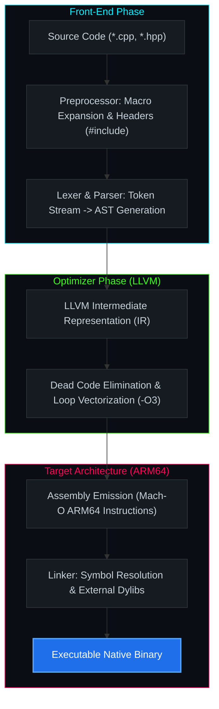
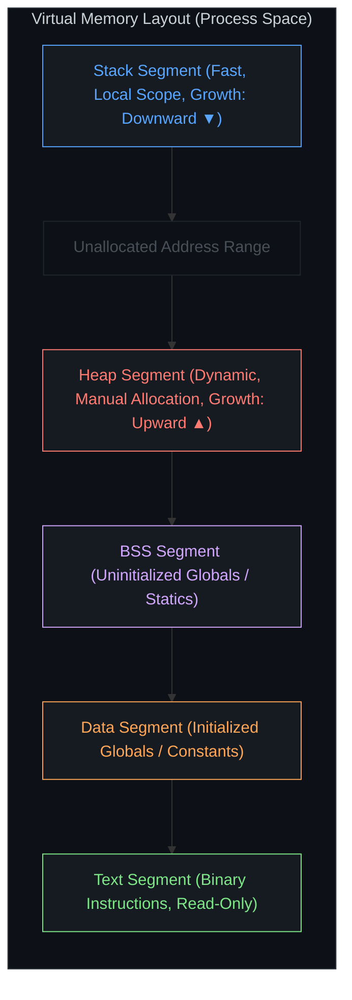
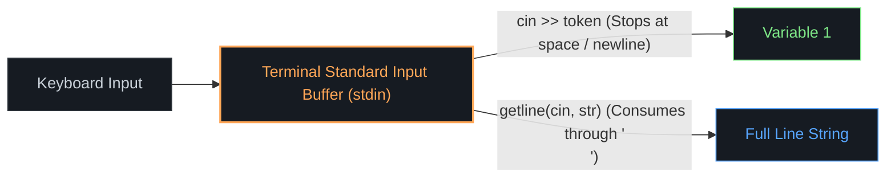

<div align="center">

```text
  ██████╗ ██████╗ ██████╗ 
 ██╔════╝██╔══██╗██╔══██╗
 ██║     ██████╔╝██████╔╝
 ██║     ██╔═══╝ ██╔═══╝ 
 ╚██████╗██║     ██║     
  ╚═════╝╚═╝     ╚═╝     
```


<br/>

[](https://isocpp.org/)
[](https://clang.llvm.org/)
[](https://eigen.tuxfamily.org/)
[](https://github.com/Shomay12/Working-with-Cpp)

</div>

---

### LOW-LEVEL SYSTEM OBJECTIVES

High-performance computing and native engine architecture require direct governance over hardware cache lines, memory pages, and pipeline branch prediction.

```text
┌───────────────────────────────────────────────────────────────────────────┐
│ SYSTEM LAYER                MECHANICS UNDER THE HOOD                      │
├───────────────────────────────────────────────────────────────────────────┤
│ Memory Allocations          Stack frame locality vs. Heap fragmentation   │
│ Instruction Pipeline        Branch predictors, cache misses, loop unroll  │
│ Hardware Registers          SIMD vector registers (NEON / AVX-512)        │
│ CPython Virtual Machine     Native C API extensions, PyObject references  │
└───────────────────────────────────────────────────────────────────────────┘
```

---

### COMPILATION & CODEGEN PIPELINE



---

### MEMORY TOPOLOGY & BIT-LEVEL REPRESENTATION



#### Two's Complement Integer Bit Layout (32-Bit System)

```text
VALUE: +100
[0] 0000000000000000000000001100100
 ▲  └───────────────┬───────────────┘
 │                  └── Magnitude (100)
 └── Sign Bit: 0 (Positive)

VALUE: -100 (Inverted bits + 1)
[1] 1111111111111111111111110011100
 ▲  └───────────────┬───────────────┘
 │                  └── Two's Complement Encoding
 └── Sign Bit: 1 (Negative)

UNDERFLOW DISRUPTION (Unsigned Interpretation):
When read as unsigned int, the sign bit becomes 2^31:
Result: 4,294,967,196 (0xFFFFFF9C)
```

---

### STREAM I/O BUFFER ARCHITECTURE



---

### REPOSITORY DIRECTORY MATRIX

```plaintext
cpp/
├── code_notes/
│   ├── intro_to_cpp/
│   │   ├── intro.cpp          # Entrypoint mechanics, standard streams
│   │   ├── v2.cpp             # Namespace isolation, Eigen vector math
│   │   ├── cpp_intro.txt      # Clang toolchain, compilation steps
│   │   └── cpp_v2.txt         # Preprocessor mechanics & header linking
│   │
│   ├── 01_varconst/
│   │   ├── v3.cpp             # Const qualifier enforcement, stream chaining
│   │   └── cpp_v3.txt         # Memory state pipeline: Store -> Process -> Display
│   │
│   └── 02_datatype/
│       ├── v4.cpp             # IEEE-754 primitives, memory width verification
│       ├── modifier.cpp       # Signed vs. unsigned bits, integer wrap-around
│       ├── typecasting.cpp    # C-style truncation, std::to_string formatting
│       ├── myString.cpp       # Memory escape sequences (\n, \t, \", \b)
│       ├── user_ip.cpp        # Stream buffer flushing & token extraction
│       └── v4.txt             # Primitive, derived, and user-defined catalog
│
├── .vscode/                   # LSP include paths & settings
├── .clangd                    # Clangd compilation arguments
├── Makefile                   # Deterministic build directives
└── README.md                  # System manual
```

---

### TOOLCHAIN EXECUTION INTERFACE

```text
┌──[ user@arm64-darwin ]─[ ~/ML_CORE/cpp ]
└──$ clang++ -std=c++17 -Wall -Wextra code_notes/02_datatype/user_ip.cpp -o user_ip
└──$ ./user_ip
```

#### Accelerated Linear Algebra (Eigen 3)
```text
┌──[ user@arm64-darwin ]─[ ~/ML_CORE/cpp ]
└──$ clang++ -std=c++17 -I/opt/homebrew/include/eigen3 code_notes/intro_to_cpp/v2.cpp -o v2
└──$ ./v2
  3  -1
2.5 1.5
```

#### Microsecond Execution Profiling
```text
┌──[ user@arm64-darwin ]─[ ~/ML_CORE/cpp ]
└──$ time ./v2
./v2  0.00s user 0.00s system 60% cpu 0.004 total
```

---

### SYSTEM ROADMAP

- [x] Compilation pipeline, namespaces, and standard stream buffers
- [x] Const correctness, immutability, and stream routing
- [x] Memory layout analysis across 32-bit and 64-bit primitive types
- [x] Two's complement integer wrap-around & underflow analysis
- [x] Typecasting, explicit conversions, and string serializations
- [x] Header-only SIMD matrix math integration (Eigen 3)
- [ ] Control flow optimizations & branch prediction mechanics
- [ ] Direct heap allocation, pointers, references, and pointer arithmetic
- [ ] Cache-coherent structures (Struct of Arrays vs. Array of Structs)
- [ ] CPython C-API bindings & native extension loading
- [ ] High-throughput data structures & memory pooling

---

<div align="center">
<sub>Shomay Singh // Systems Programming & C++ Architecture</sub>
</div>
