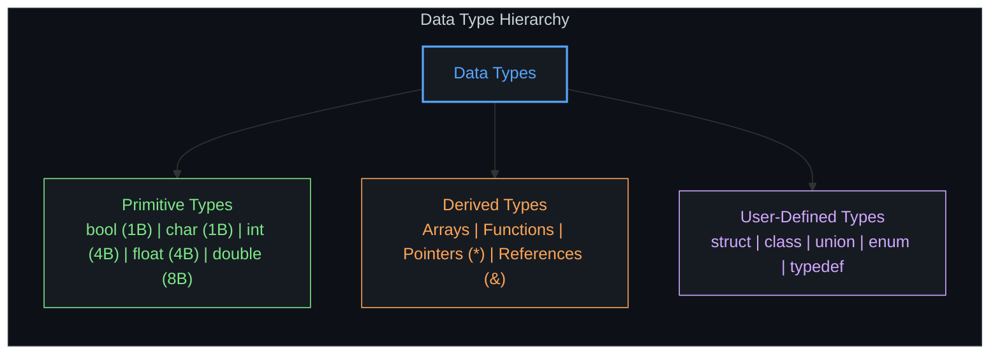

<div align="center">

```text
  ██████╗ ██████╗ ██████╗     ███╗   ███╗██╗          ██████╗ ██████╗ ██████╗ ███████╗
 ██╔════╝██╔══██╗██╔══██╗    ████╗ ████║██║         ██╔════╝██╔═══██╗██╔══██╗██╔════╝
 ██║     ██████╔╝██████╔╝    ██╔████╔██║██║         ██║     ██║   ██║██████╔╝█████╗  
 ██║     ██╔═══╝ ██╔═══╝     ██║╚██╔╝██║██║         ██║     ██║   ██║██╔══██╗██╔══╝  
 ╚██████╗██║     ██║         ██║ ╚═╝ ██║███████╗    ╚██████╗╚██████╔╝██║  ██║███████╗
  ╚═════╝╚═╝     ╚═╝         ╚═╝     ╚═╝╚══════╝     ╚═════╝ ╚═════╝ ╚═╝  ╚═╝╚══════╝
```


<br/>

[](https://isocpp.org/)
[](https://clang.llvm.org/)
[](https://eigen.tuxfamily.org/)
[](https://github.com/Shomay12/Working-with-Cpp)

</div>

---

### ARCHITECTURAL OBJECTIVE

High-performance computing, neural runtime execution, and tensor mathematics demand unmediated control over hardware memory hierarchies, cache alignment, and instruction throughput.

This repository tracks the systematic breakdown and reconstruction of low-level systems programming in C++:
* **Hardware Memory Mechanics:** Pointer arithmetic, stack vs. heap allocation, memory alignment, cache spatial/temporal locality.
* **CPython Execution Layer:** Demystifying CPython object models (`PyObject`), reference counting, and high-throughput C/C++ extension bindings.
* **Tensor & Inference Runtimes:** Constructing custom SIMD-optimized linear algebra operations, GEMM kernels, and compute graphs from first principles.

---

### COMPILATION PIPELINE


---

### REPOSITORY MATRIX

```plaintext
cpp/
├── code_notes/
│   ├── intro_to_cpp/
│   │   ├── intro.cpp          # I/O streams and runtime entrypoints
│   │   ├── v2.cpp             # Namespace isolation, Eigen matrix allocations
│   │   ├── cpp_intro.txt      # Compilation stages & architecture notes
│   │   └── cpp_v2.txt         # Linker & header resolution mechanics
│   │
│   ├── 01_varconst/
│   │   ├── v3.cpp             # Memory immutability, const semantics, stream routing
│   │   └── cpp_v3.txt         # Memory lifecycle: Allocation -> Mutation -> Sink
│   │
│   └── 02_datatype/
│       ├── v4.cpp             # IEEE-754 floats, integer representations
│       ├── modifier.cpp       # Signed vs. unsigned bits, integer wrap-around & underflow
│       ├── typecasting.cpp    # Explicit C-style casting, numeric string serialization
│       ├── myString.cpp       # Byte sequences, escape control characters
│       ├── user_ip.cpp        # Stream buffering: cin vs. getline
│       └── v4.txt             # Primitive, derived, and user-defined type definitions
│
├── .vscode/                   # LSP & include path configurations
├── .clangd                    # Clangd flags (-I/opt/homebrew/include/eigen3)
├── Makefile                   # Deterministic build directives
└── README.md                  # System architecture manual
```

---

### MEMORY & TYPE TOPOLOGY



#### Core Hardware & Language Mechanics
* **Bit Widths & Modifiers:** `unsigned int` shifts the signed integer range $[-2^{31}, 2^{31}-1]$ strictly positive $[0, 2^{32}-1]$. Supplying negative literals directly invokes two's complement modulo wrap-around (`-100` becomes `4294967196`).
* **Immutability Contract:** `const` qualifiers enforce compile-time read-only storage and must be initialized at definition site.
* **Vector Math (Eigen 3):** SIMD-vectorized matrix operations executed without heap overhead via header-only template specialization.

---

### TOOLCHAIN COMMANDS

#### Native Binary Compilation
```zsh
clang++ -std=c++17 -Wall -Wextra code_notes/02_datatype/user_ip.cpp -o user_ip
./user_ip
```

#### Linear Algebra Target (Eigen Integration)
```zsh
clang++ -std=c++17 -I/opt/homebrew/include/eigen3 code_notes/intro_to_cpp/v2.cpp -o v2
./v2
```

#### CPU Cycle Instrumentation
```zsh
time ./v2
```

---

### EXECUTION ROADMAP

- [x] Compilation pipeline, namespaces, and standard stream buffers
- [x] Const correctness, immutability, and stream routing
- [x] Memory layout analysis across 32-bit and 64-bit primitive types
- [x] Two's complement integer wrap-around & underflow analysis
- [x] Typecasting, explicit conversions, and string serializations
- [x] Header-only SIMD matrix math integration (Eigen 3)
- [ ] Control flow optimizations & branch prediction mechanics
- [ ] Direct heap allocation, pointers, references, and pointer arithmetic
- [ ] Cache-coherent structures (Struct of Arrays vs. Array of Structs)
- [ ] CPython C-API bindings & native extension loading
- [ ] Custom lightweight tensor computation engine

---

<div align="center">
<sub>Shomay Singh // Machine Learning Core & Systems Research</sub>
</div>
