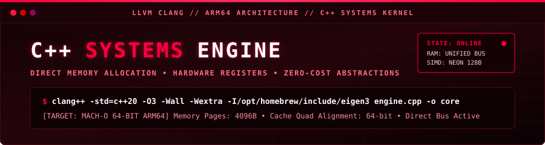
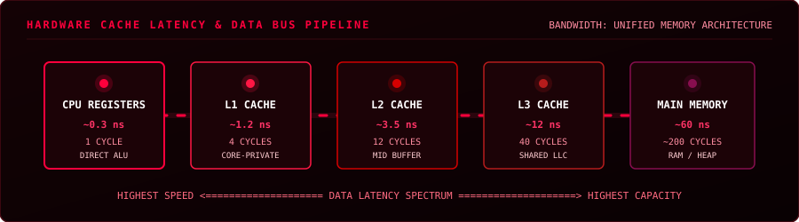
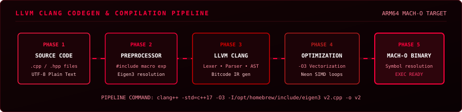
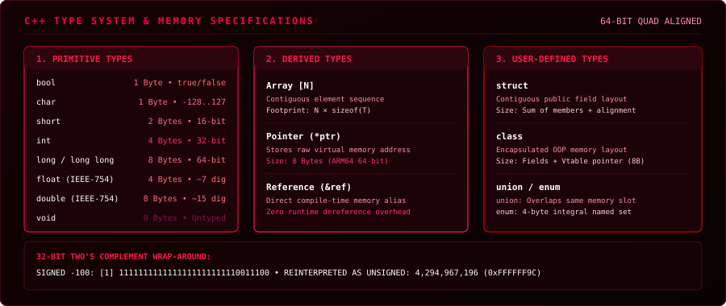
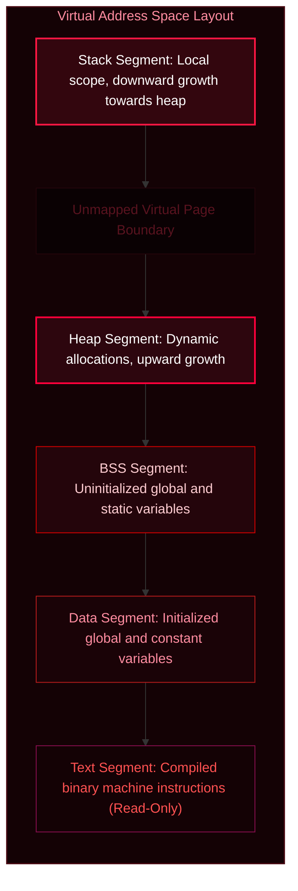
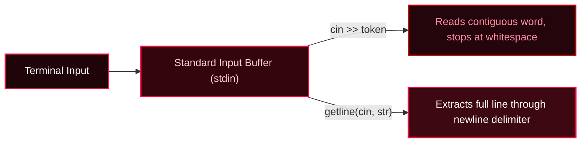

<div align="center">



<br/>

[](https://isocpp.org/)
[](https://clang.llvm.org/)
[](https://eigen.tuxfamily.org/)
[](https://github.com/Shomay12/Working-with-Cpp)

</div>

---

## 1. HARDWARE CACHE & MEMORY ACCESS PIPELINE

<div align="center">



</div>

---

## 2. LLVM CLANG CODEGEN & COMPILATION PIPELINE

<div align="center">



</div>

---

## 3. C++ TYPE SYSTEM & MEMORY SPECIFICATIONS

<div align="center">



</div>

---

## 4. VIRTUAL MEMORY PROCESS TOPOLOGY



---

## 5. STREAM I/O BUFFER HANDLING



---

## 6. REPOSITORY CODE MATRIX

```plaintext
cpp/
├── assets/
│   ├── banner.svg             # Animated vector red-theme header
│   ├── cache_hierarchy.svg    # Animated hardware cache latency pipeline
│   ├── compilation_pipeline.svg # Animated LLVM compilation flow
│   └── type_matrix.svg        # Graphical type system matrix & underflow map
│
├── code_notes/
│   ├── intro_to_cpp/
│   │   ├── intro.cpp          # Entrypoint structure and stream output
│   │   ├── v2.cpp             # Namespace partitioning and Eigen matrix math
│   │   ├── cpp_intro.txt      # Compilation stages, language background
│   │   └── cpp_v2.txt         # Linker mechanics and header inclusion
│   │
│   ├── 01_varconst/
│   │   ├── v3.cpp             # Const immutability and stream concatenation
│   │   └── cpp_v3.txt         # Memory lifecycle: Store -> Process -> Display
│   │
│   └── 02_datatype/
│       ├── v4.cpp             # Primitive variable allocation
│       ├── modifier.cpp       # Signed vs. unsigned bits and underflow
│       ├── typecasting.cpp    # Explicit truncation and string conversion
│       ├── myString.cpp       # Escape control characters (\n, \t, \", \b)
│       ├── user_ip.cpp        # Stream buffering: cin vs. getline
│       └── v4.txt             # Primitive, derived, and user-defined catalog
│
├── .vscode/                   # Editor include paths
├── .clangd                    # Clangd compilation flags
├── Makefile                   # Build directives
└── README.md                  # Documentation
```

---

## 7. TOOLCHAIN COMMANDS

### Standard Compilation
```zsh
clang++ -std=c++17 -Wall -Wextra code_notes/02_datatype/user_ip.cpp -o user_ip
./user_ip
```

### Linear Algebra Target (Eigen 3 Integration)
```zsh
clang++ -std=c++17 -I/opt/homebrew/include/eigen3 code_notes/intro_to_cpp/v2.cpp -o v2
./v2
```

### Process CPU Time Profiling
```zsh
time ./v2
```

---

## 8. PROGRESS TRACKER

- [x] Preprocessor directives, namespaces, and main function entrypoints
- [x] Variable declaration, mutation, and `const` immutability
- [x] Stream output (`cout <<`), format chaining, and avoiding pointer math bugs
- [x] Primitive types, bit widths, and IEEE-754 float precision
- [x] Integer modifiers (`signed`, `unsigned`, `long`, `short`) and underflow
- [x] Explicit type conversion (`(int)x`) and string serialization (`to_string`)
- [x] Escape sequences (`\n`, `\t`, `\"`, `\b`) and string operations
- [x] Input streams: token reading (`cin >>`) vs line reading (`getline`)
- [x] Third-party header-only integration: Eigen 3 for linear algebra
- [ ] Conditionals, logical operators, and switch statements
- [ ] Loops (`for`, `while`, `do-while`) and iteration performance
- [ ] Pointers, memory addresses (`&`), dereferencing (`*`), and pointer arithmetic
- [ ] Dynamic memory allocation (`new`, `delete`) and heap management
- [ ] Structs, classes, access specifiers, and object lifecycles

---

Shomay Singh
